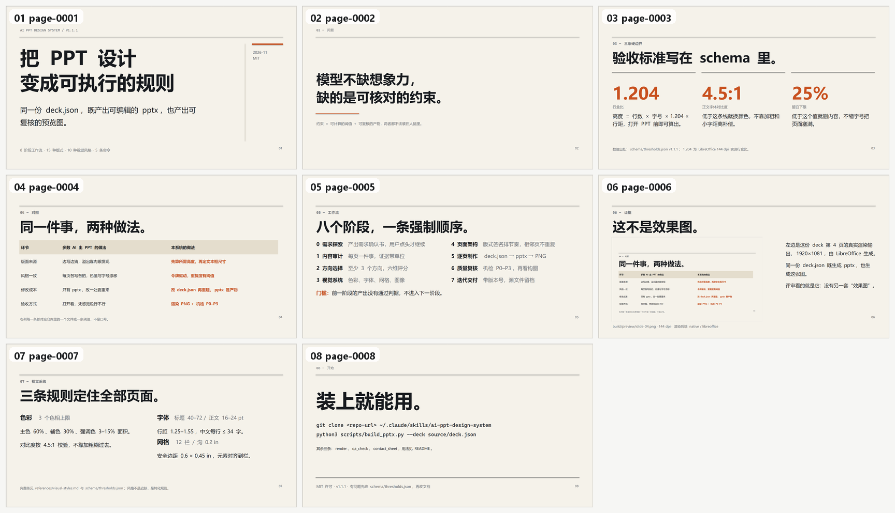

# AI PPT 设计系统

<!-- selfcheck-ignore-banned：本文件在"通病"一栏里引用反例原话，属于必须出现的引用 -->

> 一个能被任意 AI 直接下载执行的**通用 AI 设计系统**：以设计知识库为核心，用工作流指导 AI 做设计决策，再用各媒介的工具链完成实现、检查与交付。
> **PPT 是第一种被完整实现和验证的媒介，不是项目的最终边界。** 下一步是文档（docx/pdf）与固定版面，路线见 [docs/lighthouse-plan.md](docs/lighthouse-plan.md)。
> 不是模板库，不是提示词合集：是「问清楚 → 判断方向 → 定规则 → 排节奏 → 生成 → 自查 → 交付」的完整流程，外加一套真的能跑的工具链。

---

## 它解决什么

现有 AI 做 PPT 有四个通病，本系统逐条对症：

| 通病 | 症状 | 本系统的对策 |
|---|---|---|
| 跳过内容直接套模板 | 拿到需求立刻给"四宫格 + 圆角卡片 + 渐变" | 强制阶段 0–2：先问清受众与目的、拆出论点证据、给出 ≥3 个实质不同的方向再动手 |
| 只会说形容词 | "简洁大气""突出重点""有层次"，但落不到版面 | 全部规则换成数值：标题 ≥ 36 pt、正文 ≤ 34 字/行、留白 ≥ 25%、对比度 ≥ 4.5:1 |
| 单页思维 | 20 页同一构图，讲完没有推进感 | 阶段 4 规划整份页面：版式签名不得相邻重复、能量曲线、疏密交替 |
| 交付即完成，无法验证 | 文字溢出、对比度不足、图表没单位，没人发现 | 版面写成 `deck.json`，生成后**渲染成图逐页看**，再用 `qa_check.py` 分级报错（P0–P3） |

---

## 它怎么工作

```
用户一句"帮我做个答辩 PPT"
        │
   ① 需求探索 ── 每轮只问 1–3 个问题，把"高级感"翻译成参数
        │        产出 requirement-summary.md（已确认 / AI 建议 / 暂定假设）
   ② 内容审计 ── 拆论点、证据、数据、缺口，标注不能编的部分
   ③ 方向选择 ── ≥3 个实质不同的方向 × 六维评分，选一个并说明理由
   ④ 视觉系统 ── 色彩角色 / 字体阶梯 / 网格 / 图像规则，落成 tokens
   ⑤ 页面架构 ── 逐页核心信息 + 版式编号 L01–L15 + 节奏曲线
   ⑥ 逐页制作 ── 写 deck.json → build_pptx.py → deck.pptx
        │                        └→ render.py → preview/*.png
   ⑦ 质量检查 ── qa_check.py（结构）+ 逐页看图（视觉）→ 修 → 重渲染
   ⑧ 交付     ── 版本化打包 + 遗留问题清单
```

**关键设计是 spec-first**：版面不是让模型"手写 PPTX 然后祈祷"，而是先写成声明式 `deck.json`，再由脚本构建。这样版面才**可计算、可检查、可复现**。

```bash
python scripts/probe.py                                    # 探测环境能力
python scripts/build_pptx.py --deck source/deck.json --out build/deck.pptx
python scripts/render.py   --pptx build/deck.pptx --out-dir build/preview
python scripts/qa_check.py --deck source/deck.json --out records/qa-report.md
python scripts/contact_sheet.py --dir build/preview --out build/contact-sheet.png
```

生成的 PPTX 里，文字是文字、形状是形状、图表是**可编辑的原生图表**，不是一张大图。

---

## 快速开始

### 方式一：把链接丢给你的 AI（推荐）

把下面这段话连同仓库链接发给你的 AI：

```
把这个仓库安装为我的本地 skill：https://github.com/DaCuem/ai-ppt-design-system
1) clone 或下载解压到你的 skills 目录，目录名保持 ai-ppt-design-system，根目录必须有 SKILL.md
2) 安装后读 SKILL.md，按第 1 节判断何时启动
3) 运行 python scripts/probe.py，把能力矩阵报给我，缺什么依赖也说清楚
4) 告诉我装在哪、怎么用
```

### 方式二：手动安装

```bash
git clone https://github.com/DaCuem/ai-ppt-design-system ~/.claude/skills/ai-ppt-design-system   # 换成你自己的 skills 目录
```

各宿主默认目录见 [install.md](install.md)。

### 方式三：不用 skill 机制

把仓库放任意位置，在对话里说"读 `<路径>/SKILL.md` 并严格执行"，效果相同。

---

## 仓库结构

```
SKILL.md                 主控制器：何时启动、8 阶段门槛（含 1.5 文案）、红线、命令
README.md                本文件
install.md               安装与平台差异
CONTRIBUTING.md          写作规范（禁用词表、三段式、阈值唯一来源）
discovery/               需求探索：对话指南 / 问题库 / 视觉偏好 / 参考拆解 / 确认书
references/              设计知识：原则 / 10 种视觉风格 / 15 种版式 / 字体 / 色彩 /
                         文案规格 / 去 AI 味 / 外部参考
                         图像 / 图表 / 节奏 / 可读性 / 16 条反模式
references/further-reading.md  外部参考资源：10 种风格 + 通识 + 字体许可，共 29 条带核验日期的链接（可选读）
references/preference-memory.md  本地偏好记忆：满意后问一次，只存本机、永不上传（跨 deck/doc/pdf 通用）
workflows/               阶段 0–7 与 1.5 的操作手册（输入、步骤、判据、分支、失败处理）
templates/               需求确认书 / 项目简报 / 文案稿 / 换模型改写交接词 / 设计方案 / 页面大纲 / 单页规格 / 质检报告
schema/                  deck.schema.json（版面契约）+ thresholds.json（阈值唯一真值）
scripts/                 probe / build_pptx / render / qa_check / contact_sheet / copy_check / pref_memory
examples/                3 份分析示例 + 3 个完整案例（学术 / 工程 / 创意）
demo/                    8 页旗舰示例：deck.json、pptx、逐页 PNG、总览图、QA 报告
assets/                  素材与许可记录规范
docs/                    环境报告、验证报告、需求探索测试记录、阶段性总结
                         `lighthouse-plan.md` 灯塔级长期规划（契约级：定位、原则 P1–P7、跑偏判据、阶段 0–4、评估制度）
                         `capability-status.md` 能力状态四级表（已验证 / 已实现未验证 / 实验中 / 仅规划）
                         `design-core-boundary.md` 共享设计核心 vs 幻灯片适配层 vs 新媒介
                         `stage0-direction-evidence.md` 阶段 0 方向证据操作手册（A/B 消融、门禁 G0）
                         `evaluation/` 基准任务、消融协议、结果目录；`decisions/` ADR 决策记录
                         `project-summary.md` 做到哪 / 凭什么 / 还差什么
                         `v2-plan.md` + `v2-plan-ops.md` 文档与固定版面分支的规划书与操作书（尚未开工）
                         `v2-revision-notes.md` 上面两份按外部审阅意见修订的逐条处理记录
                         `docs/governance.md` 协作治理：谁能改什么、规划如何不被改乱、fork 与发布边界
```

---

## 证据：不是"能跑"，是跑过的结果

本仓库自带一份 8 页的旗舰示例，四步流水线全跑通、机检 0 问题、逐页看过：



| 可查的东西 | 在哪 |
| --- | --- |
| 版面源文件（声明式） | [demo/source/deck.json](demo/source/deck.json) |
| 可编辑 PPTX（156,716 B / 8 页） | [demo/build/deck.pptx](demo/build/deck.pptx) |
| 逐页渲染图（1920×1081 × 8） | [demo/build/preview/](demo/build/preview/) |
| 机检报告（`P0=0 P1=0 P2=0 P3=0`） | [demo/build/qa.md](demo/build/qa.md) |
| 制作过程与已知弱点 | [demo/README.md](demo/README.md) |
| 验证矩阵与没验证的部分 | [docs/validation-report.md](docs/validation-report.md) |

`docs/validation-report.md` 里有一张表，记录这份 deck 的 QA 是怎么从 **20 条问题**（第一轮 `P0=0 P1=7 P2=4 P3=9`）逐轮改到 **0 条**的，以及只改 6 个色值就能整体换主题的实测结果。故意做坏的 fixture 也在 `demo/smoke/`，用来防止质检脚本退化成"永远说没问题"。

### 三个完整案例：同一套 schema，三种视觉体系

风格不是皮肤：改的是 `tokens` 与版式选择，命令链一个字都不改。

| 案例 | 页数 | 体系 | 可查产物 |
|---|---|---|---|
| [学术答辩：遮荫覆盖率与步行热舒适](examples/cases/academic-defense/README.md) | 13 | 深墨底 + 衬线标题 + 单一金色强调 | [联系表](examples/cases/academic-defense/build/contact-sheet.png)｜[deck.json](examples/cases/academic-defense/source/deck.json)｜[qa.md](examples/cases/academic-defense/build/qa.md) |
| [工程评审：GW-4200 散热方案](examples/cases/engineering-review/README.md) | 11 | 深蓝底 + 等宽承接数据 + 原生图表与表格 | [联系表](examples/cases/engineering-review/build/contact-sheet.png)｜[deck.json](examples/cases/engineering-review/source/deck.json)｜[qa.md](examples/cases/engineering-review/build/qa.md) |
| [创意提案：夜航音乐节视觉系统](examples/cases/creative-portfolio/README.md) | 9 | 纯黑 + 单一朱红 + 大标题 + 满版图片主导页 | [联系表](examples/cases/creative-portfolio/build/contact-sheet.png)｜[deck.json](examples/cases/creative-portfolio/source/deck.json)｜[qa.md](examples/cases/creative-portfolio/build/qa.md) |

三份 case 的 QA 都是 `P0=0 P1=0 P2=0 P3=0`，pptx 与逐页 PNG 都已入库，可以直接打开对照 README 的节奏表核数字。**内容全部是演示样本**（数据与图片为虚构或自绘），每个案例的 README 首段都写了这句声明。

分析类示例看这三份：[风格拆解](examples/style-analysis-example.md)、[单页拆解](examples/slide-analysis-example.md)（用 `demo/build/preview/page-0004.png` 逐项量测）、[整份节奏](examples/deck-rhythm-example.md)。

---

## 这套系统自己的设计原则

1. **可执行优先于正确**：一条无法执行的原则，价值为零。所有规则必须能落成一个动作或一次判定。
2. **阈值只有一处真值**：所有数字在 `schema/thresholds.json`，文档只引用、脚本直接读。防止"文档写 36 pt、脚本查 32 pt"。
3. **不复用模板，复用判断**：不提供固定皮肤。同一个"瑞士国际主义"用在学术答辩和产品发布上，构图与字级必须不同。
4. **先决定，再画**：没定视觉系统之前不写单页；没排完整份节奏之前不定每页版式。
5. **必须能看到结果**：生成即渲染，渲染即逐页看。不看图的"设计"是猜测。
6. **不假装**：缺素材就标示意，缺渲染器就说视觉检查未完成，做不到就写进遗留问题。

---

## 兼容性

| 项 | 要求 |
|---|---|
| 宿主 | 任何能读写文件、能执行 shell 的 AI agent（Claude Code / Codex / Cursor / Gemini CLI / DSH / 自建 agent） |
| 主路径依赖 | Python ≥ 3.10、`python-pptx` ≥ 0.6.23、`Pillow` |
| 渲染（第 2 步） | 自动探测：宿主自带渲染器 → LibreOffice（`soffice`）→ Windows PowerPoint COM。都不可用时降级为"仅结构检查" |
| 字体 | 不依赖特定字体；`tokens.fonts.fallback` 必须写明，核心信息不靠特殊字体表达 |
| 平台 | Windows / macOS / Linux 均可；脚本只用标准库 + python-pptx + Pillow |

---

## 已知限制（v1.0）

- 不做动画、切换、母版级编辑；不处理 PPT 内的视频与音频。
- 跨机器渲染可能存在字体替代差异（尤其字重），因此**校验要看本机渲染图**，不能只看 deck.json。
- 不提供素材下载与版权获取；`assets/licenses.md` 只规定记录方法。
- 视觉风格首批 10 种（规范建议 12 种），另 2 种标注为待补，不在本文档中假装已完成。
- `deck.json` 是线性元素模型：不支持母版继承与元素组合（group），复杂页面需要显式拆元素。
- 中文断行、字距由渲染器决定，`qa_check.py` 的溢出估算为**估算**，与真实渲染可能有 ±5% 误差。

---

## 许可

本仓库的文档与脚本采用 MIT 许可（见 [LICENSE](LICENSE)；`LICENSE` 只放标准 MIT 正文，便于 GitHub 正确识别）。字体、图片、图表数据等外部素材的许可**不随本仓库授予**，边界与引用规范见 [NOTICE.md](NOTICE.md)，记录方法见 [assets/licenses.md](assets/licenses.md)。

## 贡献

改动前请读 [CONTRIBUTING.md](CONTRIBUTING.md)。最低要求：禁用词为 0、规则三段式、数字带单位、文件以可判定的检查清单结尾、阈值与 `schema/thresholds.json` 一致。
