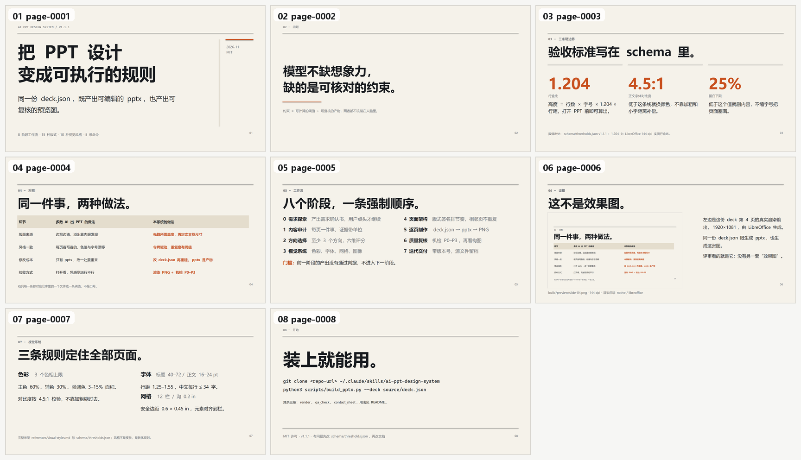

# 旗舰示例：8 页自述 deck

这是本仓库唯一一份"跑完整条流水线"的示例：`deck.json` → 可编辑 `.pptx` → 真实渲染 PNG → 机检 0 问题 → 逐页目视复核。下面的节奏表是这份 deck 的原件；`examples/deck-rhythm-example.md` 里另有一份 14 页学术汇报的节奏推演，可以对照看"8 页自述"和"14 页报告"在换气位置上的差别。



> 注：本示例 deck 内部自述版本为 **v1.1.1**，那是它最后一次**重构建**的版本；1.1.2 只改文档、没有重渲，所以没有跟着变。

## 复现

```bash
python3 scripts/build_pptx.py --deck demo/source/deck.json --out demo/build/deck.pptx
python3 scripts/render.py     --pptx demo/build/deck.pptx --out-dir demo/build/preview --dpi 144
python3 scripts/qa_check.py   --deck demo/source/deck.json --out demo/build/qa.md --json demo/build/qa.json
python3 scripts/contact_sheet.py --dir demo/build/preview --out demo/build/contact-sheet.png --cols 3
```

四步都退出码 0 才算这份示例可用。渲染器的四级降级见 `scripts/README.md`；没有渲染器的机器只能跑到第 1、3 步。

## 真实数字（本机实测，2026-11-14）

| 项 | 值 |
| --- | --- |
| `deck.pptx` | 156,716 B，8 页，缺失图片 0，警告 0 |
| 字体族 | 2：Microsoft YaHei（display + body）、Cascadia Mono（mono） |
| 渲染 | 1920×1081 PNG × 8，144 dpi，后端 `native / libreoffice`，`missingFonts: []` |
| QA | `P0=0 P1=0 P2=0 P3=0 issues=0 pages=8 exit=0` |
| 单页元素数 | 9 / 6 / 10 / 5 / 6 / 6 / 6 / 8（上限 14） |
| 文本块数 | 每页 ≤ 4（`density.maxTextBlocksPerSlide`） |
| 预览图总量 | 8 张共 843 KB |

## 视觉系统（`demo/source/deck.json` 的 tokens）

- 底 `#F5F2EA`（纸感暖白），次底 `#E4DDCD`，正文 `#171A1E`，弱化 `#6A6E74`，主色 `#1F3B33`（墨绿），强调 `#C8501E`（砖橙）。
- 三色相：暖白（底）、墨绿（主）、砖橙（强调）。橙色只出现在 3 处：KPI 数字、对照表右列、封面与页脚的短横线。
- 字号阶梯只用了 6 档：64 / 44 / 26 / 24 / 17 / 12 / 11 / 10 pt。正文 17 pt 是 deliberate 的中间档——16 pt 是下限，24 pt 是 lead，取中间才不会在 1080p 投影上过小、在 4:3 老投影上溢出。

## 页面节奏表

| # | 版式 | 网格 | 焦点 | 与前一页的对比 | 这一页的任务 |
| --- | --- | --- | --- | --- | --- |
| 01 | L01 cover | full-bleed-left | 中左 | — | 给出唯一一句主张 |
| 02 | L03 statement | single-statement | 中左 | 元素 9→6，密度骤降 | 把主张压成一句可复述的话 |
| 03 | L08 data-focus | 3-col-kpi | 底部居中 | 焦点下移 + 出现数字 | 三个可核对的阈值 |
| 04 | L05 comparison | 5-5-split | 中中 | 从竖向堆叠改为横向对照 | 老做法 vs 本仓库做法 |
| 05 | L07 process | single-column-list | 左上 | 回到左对齐、密度再降 | 八阶段顺序与门禁 |
| 06 | L04 evidence | image-7-4-split | 中左 | 文字为主 → 图片为主 | 用真实渲染图自证 |
| 07 | L13 editorial | 5-6-asym-split | 中中 | 双栏、无图 | 三条视觉规则 |
| 08 | L15 closing | full-bleed-left | 中左 | 回到封面同签名 | 可复制的命令 |

相邻页签名各不相同，同一签名占比 1/8 = 12.5%（上限 35%）。第 2 页与第 8 页共用 focalPosition=ml，但 layout 不同，不构成重复。

## 制作过程中真实踩到的 5 个坑（都已在 `deck.json` 里修掉）

1. **横线变斜线**：`line` 元素用 `x2 / y2` 定端点，改 `y` 必须同时改 `y2`。第 3 页的三条分栏线曾斜着穿过标题。
2. **大字号撑爆列**：64 pt 数字配 `lineHeight: 1.5` 时单行占 1.6 in，把三列 KPI 的说明文字挤出画布。改成 56 pt + `lineHeight: 1.25`，单行 0.94 in。
3. **两列不齐**：左右两栏逐行对齐靠的是**相同的 `spaceBeforePt`**，不是相同起点 y。第 5 页名称列与说明列曾错开半行。
4. **图片压住出处行**：图片 `y=2.85 h=3.9` 时下沿 6.75，出处行在 6.78，只差 0.03 in。给图片留到 6.75 以内、出处行抬到 6.78 才过 `qa.overflowToleranceIn=0.02`。
5. **证据页要真图**：第 6 页那张图不是 draw.io 画的，是把第 4 页渲染成 PNG 后复制进 `demo/source/assets/page-04.png` 再构建的——图片和 pptx 出自同一次构建，才叫证据。

## 已知弱点（不打算在两小时内解决，也不打算藏起来）

- 第 3 页标题末字与三条分栏线的间距只有 0.15 in，在 4:3 投影上会显得挤。改法：把分栏线下移到 y=3.15，KPI 数字上移 0.1 in。
- 第 5 页下方 1.9 in 是空的。这是刻意的"疏"页（前后都是密页），但它和第 7 页的疏叠加在一起，翻页时连续两页偏轻。改法：把第 7 页的出处行换成一张小示意图，或把第 8 页提前做收尾。
- 全套只验证了 16:9 + Microsoft YaHei。换字体（如 Noto Sans SC）时行盒比仍是 1.204，但中文断行位置会变，`qa_check.py` 的每行字数判定随之变化，需要重跑而不是照抄这份结论。

## 检查清单

- [ ] 四步命令全部退出码 0，`demo/build/qa.md` 的统计行为 `P0=0 P1=0 P2=0 P3=0`。
- [ ] `build_pptx.py` 摘要里「缺失图片：无」「警告：0」。
- [ ] 预览图为 1920×1081；若分辨率不符，先查 `--dpi 144` 是否被漏传。
- [ ] 8 张 PNG 逐页看过，没有文字压边、图片压字、元素出画布。
- [ ] 相邻页的 layout 不相同；同一 layout 出现次数 ≤ 3。
- [ ] 强调色橙色只出现在 KPI、对照表右列、短横线三处。
- [ ] 修改 `deck.json` 后重新跑满四步；只改 pptx 会在下次构建被覆盖。
