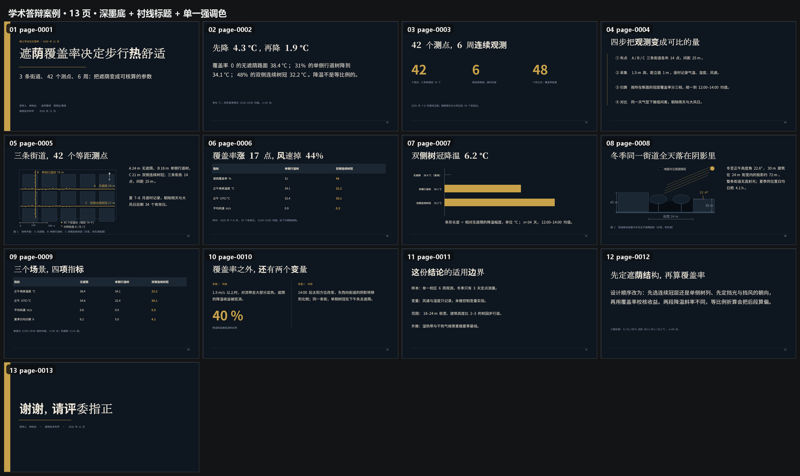

# 学术答辩案例：遮荫覆盖率决定步行热舒适

> **诚实限制**：本案例的论文题目、作者、导师、场地、测点与全部数值均为**演示用途的虚构样本数据，数字不对应任何真实研究**。图表由本地脚本绘制，不是实测底图或实测剖面。案例的用途是展示"学术答辩"这一类场景的版式、节奏与质检流程，不是提供研究结论。任何引用本文数字的行为都不成立。

一个 13 页的硕士学位论文答辩 deck：从 `brief.md` 的 15 个字段出发，走完内容审计 → 版式选择 → 元素坐标 → 构建 → 渲染 → QA → 目视复核的全过程，产物留在 `build/` 里，可以重新构建、重新渲染、重新质检。

- 源文件：`source/deck.json`（40,044 字节）
- 构建产物：`build/deck.pptx`（147,928 字节，13 页）
- 渲染预览：`build/preview/page-0001.png` … `page-0013.png`（1920×1081，144 dpi）
- 质检报告：`build/qa.md` / `build/qa.json`
- 联系表：`build/contact-sheet.png`（2300×1370，4 列 × 4 行）

## 1. 场合与受众

| 项 | 内容 |
|---|---|
| 场合 | 校内硕士学位论文答辩，阶梯教室，投影 4:3 裁切为 16:9 输出 |
| 受众 | 答辩委员会 5 人（含导师 1 人）+ 旁听 20–30 人，座位距离屏幕 3–8 m |
| 时长 | 陈述 12 分钟，问答 8 分钟；13 页对应约 55 秒/页 |
| 目的 | 让评委在 12 分钟内记住一句结论、三档数据、两条边界，并愿意在问答里就"单指标控制"提问 |
| 决策角色 | 主席与两位外审决定分数；导师不投票但会追问方法细节 |

学术答辩的注意力曲线和发布会不同：评委是在**核对**，不是在被说服。所以每一页都必须能被单独抽出来看——标题是结论句，数据带 n 与时间窗，图注写明"示意"，没有一页依赖前一页的口气。

## 2. 风格选择：深墨底 + 衬线标题 + 单一强调色

`demo/` 那份旗舰示例是纸感浅色（#F5F2EA 底 / 无衬线标题 / 橙红强调）。本案例必须与它明显不同，选的是另一套体系：

| 角色 | token | 值 | 理由 |
|---|---|---|---|
| 底 | `bg` | `#0E1620` | 深墨蓝，投影在暗教室时边框不刺眼；纯黑会让衬线笔画发虚 |
| 面板 | `bgAlt` | `#1B2733` | 表头带与图内填充，与底对比 1.21:1，只做分区不做强调 |
| 正文 | `fg` | `#EDE6D8` | 暖白，对底 15.24:1；比纯白低一档，长句不刺眼 |
| 次级 | `fgMuted` | `#8C99A6` | 眉标、图注、页码，对底 4.94:1（≥ 4.5） |
| 强调 | `accent` | `#C8A24A` | **全 deck 唯一强调色**（芥末金）；只出现在数字、编号、竖线、条形 |
| 线 | `line` | `#35485A` | 分隔线与图内轮廓，对底 1.53:1，弱到只做结构暗示 |

字体三族，不多不少（COL-03 上限 3）：

| 角色 | 字体 | 用途 |
|---|---|---|
| display | Source Han Serif SC | 封面标题、每页 h1；答辩场合的"论文感"来自衬线标题 |
| body | Noto Sans SC | 正文、表格、图注；投影下小字的清晰度优先 |
| mono | Cascadia Mono | 眉标编号 `01 /`，等宽数字让页码与编号对齐 |

字号阶梯（`tokens.type`，全部落在 `schema/thresholds.json` 的下限之上）：

| role | size | weight | lineHeight | 用在哪 |
|---|---|---|---|---|
| coverTitle | 60 | 700 | 1.06 | 封面标题、收尾页 |
| h1 | 40 | 700 | 1.10 | 每页结论句 |
| lead | 26 | 400 | 1.45 | 陈述页正文、封面副标题 |
| body | 18 | 400 | 1.50 | 正文、表格外的说明 |
| kpi | 64 | 700 | 1.00 | 三个规模数字、40 % |
| caption | 12 | 400 | 1.35 | 图注、样例说明 |
| source | 11 | 400 | 1.30 | 数据出处（本案例未使用 `source` 元素，出处写在 caption 里） |
| pageNumber | 10 | 400 | 1.00 | 右下页码 |

h1 : body = 40 : 18 = 2.22，落在 TYP-02 的 1.3–3.0 之间。accent 只出现在眉标编号、左侧竖线、3 个 KPI 和 1 组条形上，单页最多 3 处；未逐页量测色块面积，按元素 bbox 粗估最高不超过 8%，低于 `accentAreaShareRange` 上限 15%。

## 3. 版式节奏表

`ws` = 元素 bbox 并集之外的空白占比（`qa_check.py` 的 DEN-05 口径，0.1 in 栅格，排除 `zRole=bg/bgDecor`）；`ink` = 渲染图非底色像素占比（每 2 px 抽样，阈值 18/255）。两者一起看：`ws` 高说明元素框少，`ink` 高说明这一页真的黑。

| 页 | 标题 | layout | gridTemplate | focal | 元素 | 文本块 | 字数 | ws | ink | 与前页的对比 |
|---|---|---|---|---|---|---|---|---|---|---|
| s01 | 遮荫覆盖率决定步行热舒适 | cover | full-bleed-left | ml | 7 | 2 | 101 | 64.7% | 8.13% | —（开场，左边缘色条定调） |
| s02 | 先降 4.3 °C，再降 1.9 °C | statement | single-statement | mc | 6 | 2 | 140 | 59.1% | 4.00% | 从满版封面跳到单句陈述，墨量降到最低一档 |
| s03 | 42 个测点，6 周连续观测 | data-focus | 3-col-kpi | bc | 11 | 4 | 103 | 64.2% | 3.52% | 句子换成三个 64 pt 数字，元素数 +5、字数 −37 |
| s04 | 四步把观测变成可比的量 | process | single-column-list | tl | 6 | 2 | 159 | 47.4% | 4.16% | 横向三列改为纵向四步，焦点从左中移到左上 |
| s05 | 三条街道，42 个等距测点 | evidence | image-7-4-split | ml | 8 | 3 | 157 | 35.4% | 18.82% | 首次上图，墨量从上页 4.16% 跳到 18.82%（全 deck 最高） |
| s06 | 覆盖率涨 17 点，风速掉 44% | comparison | 5-5-split | mc | 6 | 1 | 79 | 39.4% | 10.98% | 图换成表，焦点从左上回到中心，字数为全 deck 最低 |
| s07 | 双侧树冠降温 6.2 °C | data-focus | bar-horizontal | tr | 12 | 2 | 115 | 64.6% | 9.41% | 表换成条形，焦点移到右上；元素数最高（12） |
| s08 | 冬季同一街道全天落在阴影里 | evidence | image-8-5-split | ml | 7 | 2 | 119 | 35.1% | 11.76% | 回到左图右文，但图片比例由 7:4 改为 8:5 避免与 s05 同签名 |
| s09 | 三个场景，四项指标 | matrix | 4x4-table | br | 6 | 1 | 64 | 41.8% | 10.13% | 满宽表格把焦点压到右下；字数为数据页最低 |
| s10 | 覆盖率之外，还有两个变量 | editorial | 5-6-asym-split | mc | 11 | 4 | 129 | 55.7% | 4.42% | 双栏 + 一个 64 pt 数字，墨量回落到 4.42% 作为换气 |
| s11 | 这份结论的适用边界 | statement | single-statement | bl | 5 | 2 | 120 | 42.4% | 3.73% | 四条边界句，无图无表，焦点压到左下 |
| s12 | 先定遮荫结构，再算覆盖率 | statement | single-statement | tl | 6 | 2 | 138 | 55.8% | 5.12% | 与 s11 同为 statement，靠 focal（bl→tl）与 gridTemplate 保持签名不同 |
| s13 | 谢谢，请评委指正 | closing | full-bleed-left | ml | 4 | 1 | 38 | 82.6% | 5.92% | 收尾回到封面同构，空白占比最高（82.6%） |

交替规律：**满版（封面/收尾）→ 单句 → 数字 → 步骤 → 图 → 表 → 条形 → 图 → 表 → 双栏 → 单句 ×2 → 满版**。同类版式不相邻：`statement` 出现在 s02 / s11 / s12，两两之间都隔着别的版式；三页 `statement` 的签名（layout + gridTemplate + focal）分别不同，REP-01/02/03 全部通过。

排这份节奏的三条规则：

**规则 1：证据页与数字页不得相邻两次**

**触发条件**：连续两页都要读者"读数"（表格、条形、KPI 行）。
**具体动作**：中间插一页要求"读句"或"看图"的页面。本案例 s06 表 → s07 条形中间没有插入，就是因为 s07 换了载体（从矩阵到条形）且焦点从 mc 移到 tr，签名差异够大；若 s07 仍是满宽表格，必须在 s06 与 s07 之间加一页 s10 那样的双栏。
**常见错误**：三页连续 KPI → 表 → 条形，读者在 2 分钟内只做一件事，第三页的数字全部读成装饰。

**规则 2：每 4 页至少一次空白占比 ≥ 55%**

**触发条件**：排到第 4 页时回数一次。
**具体动作**：本案例的换气页是 s01（64.7%）、s03（64.2%）、s07（64.6%）、s13（82.6%）；s05 与 s08 的 ws 只有 35%，靠"左图右文"的介质切换当半次换气。
**常见错误**：靠"这页字少"当换气，但字少不等于 ws 高——s02 只有 140 字、ws 却 59.1%，因为它只有两块文本；s10 有 129 字、11 个元素，ws 只有 55.7%。

**规则 3：连续三页焦点不同向**

**触发条件**：写完第 3 页后检查 focalPosition 序列。
**具体动作**：本案例序列 ml / mc / bc / tl / ml / mc / tr / ml / br / mc / bl / tl / ml，最长同向 2 页（s11–s13 里 bl→tl→ml 是三个不同方向）；连续 3 页同向就改一页的 gridTemplate。
**常见错误**：全部页 `focalPosition: ml`，翻页时眼睛不动，只有文字在换，12 分钟的答辩看起来像 13 张同一张幻灯片。

## 4. 真实数字

| 项 | 值 | 怎么得到的 |
|---|---|---|
| 源文件字节 | 40,044 B | `Get-ChildItem source/deck.json` |
| pptx 字节 | 147,928 B | `scripts/build_pptx.py --deck … --out …` |
| 页数 | 13 | 构建摘要「页数：13」 |
| 使用字体 | 3 种：Noto Sans SC、Source Han Serif SC、Cascadia Mono | 构建摘要「使用字体（3）」 |
| 缺失图片 | 无 | 构建摘要「缺失图片：无」 |
| QA 汇总 | `P0=0 P1=0 P2=0 P3=0 issues=0 pages=13 exit=0` | `scripts/qa_check.py`，阈值读 `schema/thresholds.json`（版本见该文件） |
| 渲染后端 | `dsh-native`（native / libreoffice），144 dpi | `build/preview/render-manifest.json` 的 `backend` / `rasterEngine` / `dpi` |
| 预览尺寸 | 13 张 1920×1081 px | manifest 的 `images[].width/height` |
| 缺失字体 | `[]`（无回退） | manifest 的 `missingFonts` |
| 联系表 | 2300×1370 px，4 列 × 4 行，单格 560×315 | `scripts/contact_sheet.py --cols 4` |
| 逐页元素数 | 7 / 6 / 11 / 6 / 8 / 6 / 12 / 7 / 6 / 11 / 5 / 6 / 4 | 构建摘要「逐页元素数」，上限 14 |
| 逐页空白占比 | 64.7 / 59.1 / 64.2 / 47.4 / 35.4 / 39.4 / 64.6 / 35.1 / 41.8 / 55.7 / 42.4 / 55.8 / 82.6 % | 上表 `ws` 列，下限 25% |
| 自绘素材 | `fig-site-plan.png` 58,053 B（1600×1000）、`fig-section.png` 31,552 B（1600×900） | `source/assets/make_figures.py` 用 PIL 绘制 |

`deck.pptx` 比 `deck.json` 大 107,884 B，主要来自两张 PNG（89,605 B）与 python-pptx 自带的 XML 骨架；没有嵌入字体，所以换机器打开会回退——这是 pptx 交付的既有代价，README 写在限制里。

## 5. 复现步骤

```bash
# 1) 重画两张示意图（纯本地 PIL，不访问网络）
python source/assets/make_figures.py

# 2) 构建
python scripts/build_pptx.py --deck examples/cases/academic-defense/source/deck.json \
       --out examples/cases/academic-defense/build/deck.pptx

# 3) 质检（有 P0 时退出码 1）
python scripts/qa_check.py --deck examples/cases/academic-defense/source/deck.json \
       --out examples/cases/academic-defense/build/qa.md \
       --json examples/cases/academic-defense/build/qa.json

# 4) 渲染到「不存在的目录」再搬进 build/preview（office-cli 的 render 要求输出目录不存在）
node "<office-cli.mjs>" render --input examples/cases/academic-defense/build/deck.pptx \
     --output-dir "$TEMP/cli-render" --pages all

# 5) 联系表
python scripts/contact_sheet.py --dir examples/cases/academic-defense/build/preview \
       --out examples/cases/academic-defense/build/contact-sheet.png --cols 4
```

`deck.json` 的生成脚本是一次性的（`gen_deck.py`），没有放进仓库：这份案例要展示的是**产物**与**可复核的数字**，不是生成器。改版面时直接编辑 `source/deck.json`，再跑 2)–3)。



## 6. 目视复核记录

构建与 QA 之外，13 页逐页看了一遍 `build/preview/page-XXXX.png`，改掉的问题：

| 页 | 问题 | 改法 |
|---|---|---|
| s02 | 标题"相邻街道，正午差 6.2 °C"与后页数据对不上（6.2 °C 是 0 % 与 48 % 的差，不是相邻两档） | 标题改为"先降 4.3 °C，再降 1.9 °C"，把差值拆成两段写进 lead |
| s03 | KPI 说明写"条步行道"，与"42 个测点、三条街道"冲突 | 改为"个测点，三条街道各 14 个"；第三个 KPI 由 23 改为 48（覆盖率极差 = 48 − 0） |
| s05 | 原平面图只有 2 条街，正文却说三组数据 | 重画为 A/B/C 三条街 × 14 点，比例尺与 25 m 点距统一为 2 px = 1 m |
| s07 | 条形从 0 起算，38.4 / 34.1 / 32.2 三条几乎等长，读不出 6.2 °C 的差 | 改为"相对无遮荫的降温幅度"：基准行画短线 + 4.3 / 6.2 两条条形，绝对值写在左侧标签 |
| s08 | 剖面图内 34–38 px 的字缩到 1920 px 宽的页面上约 12 pt，投影偏小；30 m 标注贴边被裁 | 图内字号提到 38–46 px、线宽 3–4 px；尺寸标注改到建筑内侧 |
| s10 | 两列正文各 2 行、下半页空 40% 以上 | 左列加 64 pt 的 "40 %"，右列正文加长到 3 行，中间加 1 px 竖线分隔 |
| s11 / s12 | 段落间距 12 pt，四行挤在页面上半部 | 段间距提到 30 pt；s12 的 lead 框高由 1.9 in 提到 2.0 in（3 行按 1.204 计算需 1.93 in） |

改完重新构建、重新 QA、重新渲染，`qa.md` 仍是 `P0=0 P1=0 P2=0 P3=0`。**机器质检通过不等于可放映**：上面 7 条里只有 3 条（s02 文案冲突、s05 图与文不符、s07 条形不可读）会被人工发现，`qa_check.py` 一条都没报——这正是本案例把目视复核写进流程的理由。

## 7. 局限与 GAPS

诚实列清楚这份案例**没做到**的事：

1. **数据全为虚构**：42 个测点、三档覆盖率、四个指标、n=34，都是为叙事编的，没有原始观测表，也没有统计检验。案例里的"结论"不能当研究结论读。
2. **两张图是示意图，不是实测底图**：平面图是规则网格上画的街区与等距点（比例 2 px = 1 m），剖面图是按 22.6° 三角函数画的几何投影；图注都写了"示意，非实测"。
3. **没有讲稿**：每页只留一句 `notes`（30–50 字），用于提示"这页先说什么"，不是逐字稿。答辩用的 12 分钟讲稿不在本案例范围。
4. **没有做真实投影验证**：字号下限按 `thresholds.json` 的 3–8 m 视距规则取，未在教室实投。若要确认 12 pt 图注能否读，需要在目标场地实测一次。
5. **没有 PDF 交付**：任务只要求 pptx 与预览图。答辩现场 U 盘拷 pptx 的字体回退风险未消除（本机有 Source Han Serif SC，评委机不一定有）。
6. **联系表留 3 个空格**：13 页放进 4 × 4 网格，最后一行只有 1 张，`scripts/contact_sheet.py` 不做自动裁剪。
7. **没有用 `source` role**：数据出处都写在 `caption` 里；`thresholds.json` 的 `source` 字号下限（9 pt）因此没有在本案例被验证。
8. **没有章节过渡页（L02）**：12 分钟里插两页过渡会挤掉证据页，所以用眉标编号 `01 /` … `11 /` 代替章节感。代价是 deck 缺少"换气"点——这一条在 `examples/deck-rhythm-example.md` 里作为节奏问题讨论。
9. **本文件 16 KB，超出 `CONTRIBUTING.md` 建议的单文件 4–12 KB**：节奏表、真实数字表、目视复核记录三张表占了近一半篇幅，压到 12 KB 要删列。要短版就看 `brief.md`（4.9 KB）与 `examples/deck-rhythm-example.md`（12,284 B）。同一批交付的两份示例正文是 12,279 B 与 12,284 B，都在 12,288 B 以内。

## 检查清单

- [ ] 15 个 brief 字段无空缺，页数（13）落在 12–14 页区间内
- [ ] `qa.md` 的汇总行是 `P0=0 P1=0 P2=0 P3=0`，未删除任何检查项
- [ ] 页数、字节数、字体数、后端名与本文件第 4 节数字一致（改版面后必须同步这张表）
- [ ] 每页 h1 是结论句（含数字或动作），不是"研究背景""结果分析"这类流程标签
- [ ] 相邻两页的 layout + gridTemplate + focalPosition 三元组不同
- [ ] 同 layout 占比 ≤ 35%（本案例 statement 3/13 = 23%）
- [ ] 每页元素 ≤ 14、文本块 ≤ 4、字族 ≤ 3
- [ ] 所有图注写明"示意"与"虚构数据"，正文没有把虚构数字写成实测
- [ ] 强调色只有 1 个（#C8A24A），且每页面积 ≤ 15%
- [ ] 预览图与 `deck.pptx` 同一次构建（比对 `render-manifest.json` 的 `sourceSha256`）
